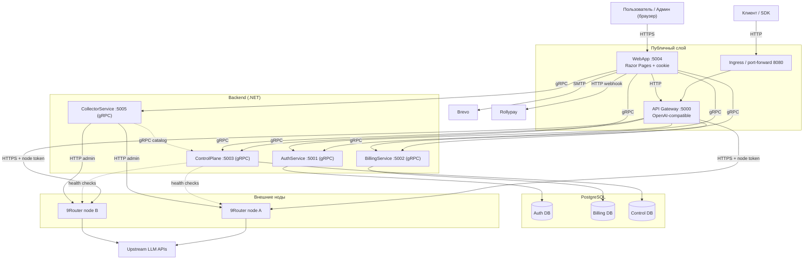
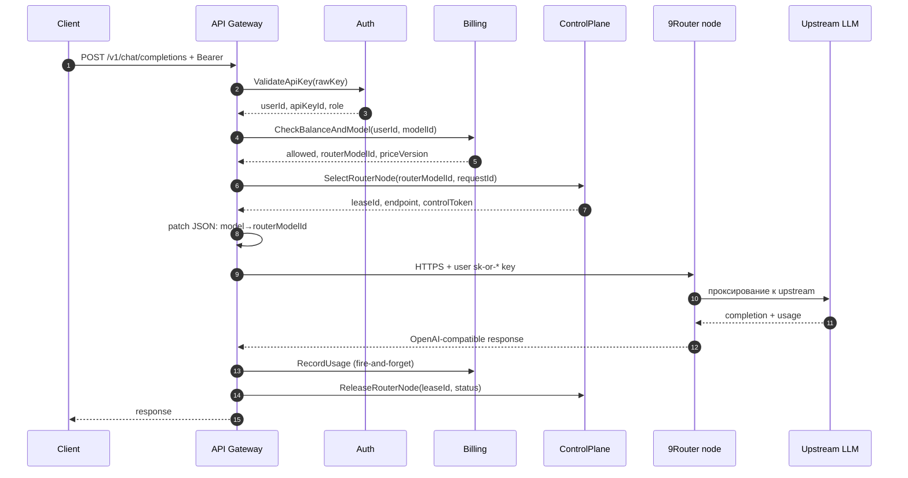

# OpenRussiaRouter — полная документация проекта

> Версия: июнь 2026 · Технологический стек: .NET 8 / C# / ASP.NET Core / gRPC / PostgreSQL / Kubernetes

---

## Содержание

1. [Обзор проекта](#1-обзор-проекта)
2. [Архитектура](#2-архитектура)
3. [Доменные модели и бизнес-инварианты](#3-доменные-модели-и-бизнес-инварианты)
4. [Сервисы (микросервисы)](#4-сервисы-микросервисы)
   - [ApiGateway](#41-apigateway--публичный-http-вход)
   - [AuthService](#42-authservice--аккаунты-и-api-ключи)
   - [BillingService](#43-billingservice--деньги-и-usage)
   - [ControlPlane](#44-controlplane--реестр-9router-нод)
   - [CollectorService](#45-collectorservice--кэш-метаданных-нод)
   - [WebApp](#46-webapp--кабинет-и-админка)
5. [Shared-проекты](#5-shared-проекты)
   - [BuildingBlocks](#51-buildingblocks)
   - [Contracts](#52-contracts)
6. [gRPC-контракты](#6-grpc-контракты)
7. [Базы данных и миграции](#7-базы-данных-и-миграции)
8. [Тестирование](#8-тестирование)
9. [Конфигурация и переменные окружения](#9-конфигурация-и-переменные-окружения)
10. [Инфраструктура и развёртывание](#10-инфраструктура-и-развёртывание)
11. [Интеграция с 9Router](#11-интеграция-с-9router)
12. [Безопасность и приватность](#12-безопасность-и-приватность)
13. [Операционные процедуры](#13-операционные-процедуры)
14. [Известные ограничения и TODO](#14-известные-ограничения-и-todo)

---

## 1. Обзор проекта

**OpenRussiaRouter** — это OpenAI-совместимый LLM-шлюз с биллингом в долларах США. Платформа позволяет выдавать клиентам API-ключи, списывать стоимость запросов к LLM, маршрутизировать трафик через пул внешних proxy-нод **9Router** и управлять каталогом моделей.

### Цель MVP

Готовность к платным пилотам: выдать ключ, пополнить баланс (виртуально), отправлять запросы к LLM, считать usage, списывать стоимость, видеть ошибки и статус в админ-панели.

### Ключевые продуктовые решения

| Решение | Описание |
|---|---|
| **Аудитория** | B2B-разработчики и компании. MVP: один пользователь владеет балансом и ключами. |
| **Регистрация** | Self-serve email + пароль с 6-значным кодом верификации (отправляется по SMTP). Опционально — инвайт от администратора. |
| **Внешний API** | OpenAI-compatible: `POST /v1/chat/completions` (streaming и non-streaming), `GET /v1/models`. |
| **API-ключи** | Формат `sk-or-<36 случайных символов>`, raw отображается один раз при создании, в БД только SHA-256. |
| **Биллинг** | Prepaid-баланс в USD. Виртуальное пополнение через админку. Реальные платежи через провайдер Rollypay (подробности ниже). |
| **Тарифы** | Цены за 1 млн токенов: input/output/cache. Версия цены сохраняется в usage для аудита. |
| **Приватность** | Prompt/response bodies не сохраняются ни в БД, ни в обычных логах. |

### Не входит в MVP (non-goals)

Реальные платежи в проде, organization/team accounts, embeddings, Responses API, IP-фильтры, moderation/abuse detection, автоматическая self-registration 9Router-нод.

### Связанные проекты

- **9Router (fork):** `C:\Programs\F9Router` — Node.js/Next.js proxy-нода, через которую идёт реальный трафик к upstream LLM.
- **GitHub:** push CI билда → `ghcr.io` с тегами `sha-<commit>` и `dev-latest`. Дальше **Argo CD Image Updater** подхватывает новые образы и обновляет kustomize-патчи.

---

## 2. Архитектура

### Стек

- **Язык/фреймворк:** .NET 8 / C# 12, ASP.NET Core, gRPC (Grpc.AspNetCore 2.80.0)
- **Хранилище:** PostgreSQL 16 (один кластер, отдельные database на сервис)
- **Межсервисная связь:** gRPC (HTTP/2), keep-alive + `GrpcDeadlineInterceptor`
- **Клиентская связь:** HTTP/OpenAI-compatible для шлюза, cookie auth для WebApp
- **Персистентность:** Dapper + Npgsql, raw SQL миграции. **Entity Framework не используется.**
- **Логирование:** Serilog → Seq
- **Метрики:** OpenTelemetry → Prometheus (`/metrics`)
- **Телеметрия:** `X-Correlation-Id` header прокидывается через все сервисы
- **UI:** ASP.NET Core Razor Pages (без Blazor — миграция завершена)
- **Оркестрация:** Kubernetes + Kustomize, GitOps через Argo CD + Argo CD Image Updater
- **Тесты:** xUnit 2.5.3, FluentAssertions, Moq, Testcontainers (PostgreSQL), Playwright (E2E)
- **Платежи:** Rollypay (провайдер), SMTP через Brevo

### Высокоуровневая диаграмма



### Поток `POST /v1/chat/completions`



### Карта решений проекта

| Сервис | Назначение | Порт по умолчанию |
|---|---|---|
| **ApiGateway** | Публичный OpenAI-compatible HTTP entrypoint | HTTP 5000 |
| **AuthService** | Учётные записи, сессии, жизненный цикл API-ключей | gRPC 5001 |
| **BillingService** | Леджер баланса, цены, usage, аномалии, платежи | gRPC 5002 |
| **ControlPlane** | Реестр 9Router-нод, health-чеки, лизинг, key-sync | gRPC 5003 |
| **WebApp** | Razor Pages: пользовательский кабинет + админка | HTTP 5004 |
| **CollectorService** | Периодический опрос нод + OpenRouter, in-memory снапшоты | gRPC 5005 |
| **BuildingBlocks** | Shared библиотека: Money, TokenUsage, ошибки, миграции | — |
| **Contracts** | Shared DTO + `.proto` файлы | — |

---

## 3. Доменные модели и бизнес-инварианты

### Базовые типы

#### Деньги — `MoneyAmount`

`readonly record struct (decimal Amount, Currency Currency)`, фабрика `Usd(amount)`. Операторы `+`/`-` бросают `InvalidOperationException` при разных валютах. **Везде в биллинге деньги только через `MoneyAmount`.**

В БД колонки: `numeric(18, 6)`.

#### Валюта

- Балансы и леджер — только USD.
- WebApp поддерживает отображение в `display_currency` (RUB, USD, EUR, ...). Конвертация через `CbrClient` (ЦБ РФ курсы) — периодический refresher.
- При пополнении через Rollypay: WebApp передаёт `provider_amount` + `provider_currency`, Billing сохраняет `credited_usd_amount` через FX-котировку.

#### Usage — `TokenUsage`

```csharp
record struct TokenUsage(long InputTokens, long OutputTokens, long CacheTokens);
```

**Инвариант**: `InputTokens` включает `CacheTokens` (кэш — подмножество промпта). Биллится:

```
billableInput = max(0, InputTokens - CacheTokens)   # по input-цене
cacheBilled    = CacheTokens                        # по cache-цене
cost = (billableInput * inputPrice + OutputTokens * outputPrice + cacheBilled * cachePrice) / 1_000_000
```

Округление — `MidpointRounding.ToEven` до 6 знаков (соответствует `numeric(18,6)`).

#### Извлечение usage из ответа LLM

`TokenUsageExtractor` учитывает нюансы разных провайдеров:

- Алиасы полей: `input_tokens`/`prompt_tokens`, `output_tokens`/`completion_tokens`.
- **9RFork раздувает usage на `BUFFER_TOKENS` (~2000)** для CLI — реальные значения дублируются в `usage._orr_raw`. При наличии этого объекта используются они.
- **Кэш Anthropic** (`cache_read_input_tokens`/`cache_creation_input_tokens`) — репортится отдельно от input → прибавляется к input в extractor.
- **Кэш OpenAI** (`cached_tokens`, `prompt_tokens_details.cached_tokens`) — уже внутри `prompt_tokens` → НЕ прибавляется.

### Идентификаторы

- Все ID — строковые `varchar(64)`, генерируются в коде (не используется UUID-расширение Postgres).
- API-ключи: формат `sk-or-<36 случайных base62 символов>`. Префикс 12 символов хранится отдельно для UI.
- Сессионные токены, коды верификации email (6 цифр), коды сброса пароля — генерируются через `SecretGenerator`.

### Idempotency

Все записи в леджер идут с `idempotency_key` (UNIQUE INDEX). Повторный вызов с тем же ключом возвращает уже записанный результат и не дублирует списание.

`RecordUsage` идемпотентен по `request_id` (PRIMARY KEY в `usage_records`).

---

## 4. Сервисы (микросервисы)

### 4.1 ApiGateway — публичный HTTP вход

**Назначение:** OpenAI-compatible API. Только HTTP (порт 5000), gRPC не хостит. Ходит к Auth/Billing/ControlPlane как gRPC-клиент, к 9Router-нодам — напрямую по HTTPS. **БД нет, миграций нет.**

#### Регистрация и endpoint'ы

`Program.cs` → `Startup.ConfigureServices` → `AddGatewayGrpcClients` + `AddGatewayRouter` + `AddGatewayHandlers`.

**Endpoints:**

| Метод | URL | Описание |
|---|---|---|
| `POST` | `/v1/chat/completions` | Авто-детект streaming по полю `stream`. |
| `POST` | `/v1/chat/completions/stream` | Явный streaming alias. |
| `GET` | `/v1/models` | Список enabled моделей. |
| `GET` | `/health` | Liveness. |
| `GET` | `/ready` | Readiness. |
| `GET` | `/metrics` | Prometheus (OpenTelemetry). |

В каждый ответ пишется `X-Correlation-Id` и `X-Request-Id`.

#### Архитектура обработчиков

Два ключевых класса:

**1. `GatewayPipeline.AuthorizeAndAcquireLeaseAsync`** — авторизация одного запроса. Любой провал → пишет OpenAI-ошибку в ответ, возвращает `null`:

1. `model` не пуст.
2. `BearerTokenReader.TryRead` — достаёт `sk-or-*` из `Authorization`.
3. `authProvider.AuthenticateAsync` → AuthService (UserId, ApiKeyId, ApiKeyPrefix, IsAdmin).
4. `billingProvider.CheckBalanceAndModelAsync(userId, model, adminBypassDisabled)` → Billing.
5. `controlPlaneProvider.SelectRouterNodeAsync(routerModelId, …, excludedNodeIds)` → ControlPlane.

**Важно:** в ControlPlane передаётся `balanceResult.RouterModelId` (upstream-ID ноды, напр. `glm-4.7`), а не публичный billing-ID (`ORR/GLM-4.7`) — иначе capability-store не сматчит модель.

**Admin-bypass:** заголовок `X-ORR-Admin-Test: 1` от админ-ключа разрешает disabled-модели.

**Preferred node:** заголовки `GatewayPreferredNodeHeaders.NodeId`/`NodeControlToken` → привязка к конкретной ноде (используется UI-тестом из WebApp).

**2. `ChatCompletionHandler`** — основная обработка:

- Non-streaming (`HandleAsync`): цикл retry/failover. При `StatusCode >= 400` нода добавляется в `excludedNodes`, цикл повторяется.
- Streaming (`ExecuteStreamingAsync`): retry возможен **только до первого байта** (до `IsSuccess`). После первого chunk — ретрай запрещён.

#### JSON-патчи запроса

Собирается из трёх шагов в `OpenAi/`:

- **`SseRequestPatcher.PatchModel`** — заменяет `model` на `routerModelId`.
- **`GeminiSchemaPatcher.SanitizeIfGeminiModel`** — для gemini-моделей инлайнит `$ref`/`$defs` в JSON-схемах tools/functions/response_format (Gemini не понимает `$ref`). Рекурсивно, защита от циклов `depth>32`.
- **`SseRequestPatcher.InjectStreamOptions`** (streaming) — форсит `stream:true` + `stream_options.include_usage:true`, чтобы нода вернула usage в финальном чанке.

JSON-патчеры толерантны к мусору: на `JsonException` возвращают исходную строку как есть.

#### Прокси к ноде

`YarpRouterProxyProvider` использует два разных HTTP-клиента:

- `ForwardingHttpClient` (YARP `IHttpForwarder`, non-stream).
- `StreamingHttpClient` (обычный `HttpClient`, stream).

Оба: `UseProxy=false`, без авто-декомпрессии, HTTP/2 multiplexing, `ConnectTimeout=15s`, `ActivityTimeout=5 мин`.

На ноду уходит `Authorization: Bearer <userApiKey>` (пользовательский `sk-or-*`, **не control-token!**) + `X-Correlation-Id`.

Provider-метаданные снимаются из заголовков ответа ноды `x-9r-provider` / `x-9r-account` → в usage-событие.

#### RecordUsage (fire-and-forget)

```csharp
_ = billingProvider.RecordUsageAsync(...).ContinueWith(log on faulted);
```

Никогда не ждём ответа, ошибки только логируем. Статус usage: `completed` если токены > 0, иначе `usage_missing`.

#### Маппинг ошибок Billing → OpenAI

| Billing ErrorCode | OpenAI type |
|---|---|
| `InsufficientBalance` | `billing_error` |
| `ModelUnavailable` | `invalid_request_error` |
| `RouterUnavailable` | `upstream_error` |
| и т.д. | маппинг в `GatewayErrors` |

#### Подводные камни

- **`OperationCanceledException`** = клиент отключился, это норма, особенно для SSE.
- **Стрим-ретрай только до первого байта** — после `HasStarted` нельзя сменить ноду или отдать JSON-ошибку.
- **Usage fire-and-forget** → потеря события при краше gateway (известный пробел BILLING-004).

---

### 4.2 AuthService — аккаунты и API-ключи

**Назначение:** пользователи, сессии, жизненный цикл API-ключей, email-верификация, инвайты, Google OAuth. **gRPC (порт 5001)** + HTTP `/health`. Layered: Domain → Application → Infrastructure.

#### Структура

```
src/OpenRussiaRouter.AuthService/
├── Application/
│   ├── Abstractions/        # IPasswordHasher, ISecretHasher
│   ├── Services/           # AuthAccountApplicationService (фасад),
│   │                       # LoginService, InviteRegistrationService,
│   │                       # EmailVerificationService, GoogleAuthService,
│   │                       # ApiKeyFactory, IAuthRepository, AuthErrorCodes
│   └── Extensions/         # AuthServiceExtensions
├── Domain/
│   ├── Entities/           # UserAccount, UserSession, ApiKey, Invite,
│   │                       # EmailVerification, ExternalLogin
│   └── Enums/              # UserRole (User/Admin), UserStatus
└── Infrastructure/
    ├── Grpc/               # GrpcAuthService — адаптер gRPC → фасад
    ├── Persistence/        # Dapper entities, AuthDbConnectionFactory
    ├── Repository/         # AuthRepository (PG) + InMemoryAuthRepository
    ├── Security/           # Pbkdf2PasswordHasher, Sha256SecretHasher, SecretGenerator
    ├── Http/               # /health
    └── Startup/
```

#### Ключевые операции `AuthAccountApplicationService`

| Операция | Поведение |
|---|---|
| `RegisterUserAsync` | Self-serve signup: пароль ≥ 12 (`WeakPassword` иначе); email нормализуется; дубль → `EmailAlreadyRegistered`; создаёт `UserAccount.CreateForEmailSignup` в статусе `PendingVerification`. Возвращает сырой 6-значный код. |
| `VerifyEmailAsync` | Проверяет код через `EmailVerificationService.Check`; на `Confirmed` → `user.Activate()`. Коды: `CodeExpired`, `TooManyAttempts`, `InvalidCode`, `NoPendingVerification`. |
| `ResendVerificationAsync` | `Reissue` с кулдауном → `ResendCooldown` если рано. |
| `CreateInviteAsync` (admin) | Хеш токена в БД. |
| `CompleteInviteAsync` | Резолв по `tokenHash`, создание пользователя + пометка инвайта использованным (одна транзакция). |
| `RequestPasswordResetAsync` | 6-значный код в `auth.password_resets`. Неизвестный email → `PasswordResetNotAvailable` (не раскрывает существование аккаунта). |
| `ResetPasswordAsync` | Код → новый хеш + сброс lockout + удаление reset-строки атомарно. |
| `ChangePasswordAsync` | Проверка текущего пароля. |
| `CreateApiKeyAsync` | Требует `UserStatus.Active`. Проверяет `currentKeysCount >= user.MaxApiKeys` (бросает `InvalidOperationException`). |
| `Rename/Revoke/Delete` | Бросают `KeyNotFoundException`, если не нашли. `Delete` — только над отозванным ключом. |

#### Login lockout

`LoginService`: 5 неудачных попыток → блокировка на 15 минут (`AccountLocked`). Счётчики `failed_login_count`/`locked_until_utc` мутируются на `UserAccount`, персистит через `UpdateLoginThrottleAsync`.

#### Безопасность

- **Формат ключа:** `sk-or-<36 случайных base62>`. В БД: `prefix` (12 символов) + SHA-256 `SecretHash` + `RawKey` (для пуша на ноды). Plaintext отдаётся вызывающему один раз.
- **`EmailVerificationService`:** код = `RandomNumberGenerator.GetInt32(100000, 1000000)`; TTL 15 мин (`CodeTtl`), кулдаун ресенда 60с (`ResendCooldown`), макс. 5 попыток (`MaxAttempts`).
- **`Pbkdf2PasswordHasher`** — пароли пользователей.
- **`Sha256SecretHasher`** — ключи, токены, коды.

#### Репозиторий

`IAuthRepository` имеет две реализации (PG + in-memory) — **новый метод добавлять в обе**. Транзакционные пары вынесены отдельно: `AddUserAndMarkInviteUsedAsync`, `AddUserWithEmailVerificationAsync`, `AddUserWithExternalLoginAsync`, `ActivateUserAndDeleteVerificationAsync`.

Для интеграции с нодами: `ListAllActiveApiKeysRawAsync` (raw-ключи для bulk-sync из ControlPlane), `ListActiveApiKeyHashesAsync`, `FindActiveApiKeyBySecretHashAsync`.

#### Google OAuth

Условно регистрируется: только если заданы `Google:ClientId` и `Google:ClientSecret`. Без гварда OAuth-хендлер падает с 500 на `/Login`. Создаёт/находит запись `ExternalLogin`.

#### БД

- Schema: `auth`
- Таблицы: `users`, `invites`, `api_keys`, `user_sessions`, `email_verifications`, `external_logins`, `password_resets`
- Миграции: `db/migrations/auth/` (11 файлов)

#### gRPC API (auth.proto)

Полный список в `src/OpenRussiaRouter.Contracts/Protos/auth.proto`. Основные:

- `ValidateApiKey(rawKey)` — горячий путь для Gateway.
- `Login(email, password)` — для WebApp.
- `RegisterUser / VerifyEmail / ResendVerification` — self-serve signup.
- `CreateInvite / CompleteInvite` — admin flow.
- `CreateApiKey / DisableApiKey / EnableApiKey / DeleteApiKey / ListApiKeys / RenameApiKey`.
- `ListUsers / GetUser / UpdateUser` — admin.
- `ChangePassword / RequestPasswordReset / ResetPassword`.
- `LoginOrRegisterWithGoogle` — OAuth.
- `ListAllActiveApiKeysRaw / ListAllNonDeletedApiKeysRaw` — для sync из ControlPlane.

---

### 4.3 BillingService — деньги и usage

**Назначение:** леджер баланса в USD, каталог моделей и цен, запись/агрегация usage, биллинговые аномалии, теги, платежи. **gRPC (порт 5002)** + HTTP `/health`.

#### Структура

```
src/OpenRussiaRouter.BillingService/
├── Application/
│   ├── Services/           # BillingApplicationService (фасад, partial),
│   │                       # IBillingRepository, RecordUsageResult,
│   │                       # BillingPaginationOptions, FxQuoteService
│   └── Extensions/         # BillingServiceExtensions
├── Domain/
│   ├── Entities/           # LedgerEntry, ModelPrice, UsageRecord,
│   │                       # ActivityByTokenRecord, ActivitySummary,
│   │                       # AdminRequestRecord, BillingAnomaly, Tag,
│   │                       # Payment, PaymentEvent, ApiKeyLimitSummary,
│   │                       # ApiKeySpendLimit
│   └── Enums/              # LedgerEntryType, PaymentStatus
└── Infrastructure/
    ├── Grpc/               # GrpcBillingService
    ├── Persistence/        # Dapper entities, BillingPersistenceMapper
    ├── Repository/         # BillingRepository (PG) + InMemoryBillingRepository
    ├── Auth/               # ServiceAuthInterceptor (s2s auth)
    ├── Workers/            # FxRateRefresher, PaymentEventRecoveryWorker
    ├── Http/               # /health
    └── Startup/
```

#### `BillingApplicationService` — основные операции

**`CheckBalanceAndModelAsync(userId, modelId, adminBypassDisabled)`** — hot-path для Gateway. Возвращает `BalanceCheckResult`:

- `GetEnabledModelAsync` (или `GetModelAsync` при admin-байпасе), нет → `ModelUnavailable`.
- **Бесплатная модель** (input/output/cache цены = 0) проходит при нулевом балансе.
- Платная с `balance.Amount <= 0` → `InsufficientBalance`.
- Возвращает `RouterModelId` (upstream-ID ноды) — именно его Gateway шлёт в ControlPlane и патчит в запрос.

**`RecordUsageAsync(usageEvent, nowUtc)`** — запись usage:

- **Идемпотентность по `RequestId`** (PRIMARY KEY): повтор → возвращает уже записанную стоимость, не дублирует.
- `usage.EnsureValid()`; при невалидных токенах пишет `BillingAnomaly("invalid_token_count")` и выходит.
- Если токены > 0 — резолв модели; модели нет → аномалия `model_price_missing` + usage с нулевой стоимостью; иначе `usageCostCalculator.Calculate`.
- **Одна транзакция `RecordUsageWithTransactionAsync`**: пишет `ActivityByTokenRecord` + `UsageRecord` + списание `LedgerEntry(UsageCharge, -cost)` (idempotency `usage:{requestId}`). При нулевой стоимости usage/ledger = `null`.

**`CreateVirtualTopUpAsync`** — админское пополнение (`ValidatePositiveUsd`, idempotencyKey).

**`UpsertModelAsync`** — каталог. Требует `ModelId`/`DisplayName`/`RouterModelId`/`PriceVersion`, `Price.EnsureValid()`.

**`UpsertTagAsync` / `DeleteTagAsync`** — валидация id (`TagIdRegex`, ≤50), displayName (≤100), цвет (`HexColorRegex`).

Списки активности/usage/аномалий/admin-записей — с фильтрами по apiKeyIds, датам, модели, провайдеру.

#### Пагинация

Keyset-курсор `"{createdAtUtc:O}|{id}"` (`ParseCursor`), размер из `BillingPaginationOptions.EffectivePageSize`.

#### Workers

- **`FxRateRefresher`** — периодически обновляет FX-котировки.
- **`PaymentEventRecoveryWorker`** — подхватывает stale payment events.

#### Подводные камни

- **Один active-row на модель** в `billing.model_prices` — нет versioned price history. `PriceVersion` хранится в usage для аудита, но прошлые версии цен не сохраняются (BILLING-003).
- **Usage приходит fire-and-forget** от ApiGateway по in-process gRPC — нет PG-backed outbox (BILLING-004), при потере вызова событие теряется.

#### БД

- Schema: `billing`
- Таблицы: `ledger_entries`, `model_prices`, `usage_records`, `activity_by_token`, `billing_anomalies`, `tags`, `payments`, `payment_events`, `platform_settings`, `api_key_spend_limits`
- Миграции: `db/migrations/billing/` (18 файлов)

#### gRPC API (billing.proto)

Hot-path: `CheckBalanceAndModel`, `RecordUsage`. UI: `ListPublicModels`, `GetBalance`, `CreateVirtualTopUp`, `ListUsage`, `ListBillingAnomalies`, `UpsertModelPrice`. Админ: `ListActivityByToken`, `GetActivitySummary`, `ListTopUps`, `ListAdminRequests`. Теги: `ListTags/UpsertTag/DeleteTag`. Платежи: `CreatePayment`, `AttachProviderRef`, `ConfirmPaymentByProvider`, `ApplyPaymentEvent`, `GetPayment`, `ListPayments`, `AcquireStalePayments`. Лимиты: `GetApiKeyLimitSettings`, `UpsertApiKeyLimitSettings`, `ListApiKeyLimitSummaries`. Platform settings: `GetPlatformSetting`, `SetPlatformSetting`. FX: `GetFxQuote`.

---

### 4.4 ControlPlane — реестр 9Router-нод

**Назначение:** реестр 9Router-нод, health-чеки, лизинг (least-load), capability-aware routing, синхронизация пользовательских `sk-or-*` ключей на ноды, прокси к admin API нод. **gRPC (порт 5003)** + HTTP `/health`.

#### Структура

```
src/OpenRussiaRouter.ControlPlane/
├── Application/
│   ├── Abstractions/       # IControlPlaneRepository, IRouterNodeHealthProvider, IRouterNodeProvider
│   ├── Contracts/          # RouterNodeHealthResult, RouterNodeProviderContracts
│   ├── Options/            # CapabilityReplicaOptions, RouterHealthCheckOptions,
│   │                       # RouterLeaseCleanupOptions, RouterNodeProviderCacheOptions
│   ├── Services/           # RouterControlPlaneService (фасад выбора ноды),
│   │                       # NodeModelCapabilityStore
│   └── Extensions/         # ControlPlaneExtensions
├── Domain/
│   └── Entities/           # RouterNode, RouterLease
└── Infrastructure/
    ├── Grpc/               # GrpcRouterControlPlaneService
    ├── Http/               # RouterNodeProvider (admin API),
    │                       # RouterNodeHealthProvider, CachedRouterNodeProvider
    ├── Persistence/        # Dapper entities, ControlPlaneDbConnectionFactory
    ├── Repository/         # ControlPlaneRepository + InMemoryControlPlaneRepository
    ├── Workers/            # RouterHealthCheckWorker, RouterLeaseCleanupWorker,
    │                       # CapabilityReplicaRefresher
    ├── Http/               # /health
    └── Startup/
```

#### `RouterControlPlaneService.SelectRouterNodeAsync` — алгоритм

Hot-path:

1. `ReleaseExpiredLeasesAsync(nowUtc)` — снять протухшие лизы (TTL `DefaultLeaseTtl` = 5 мин).
2. Кандидаты = ноды с `Enabled && Status==Healthy`.
3. **Capability-фильтр:** если `modelId` задан **и** `!capabilityStore.IsEmpty` → оставить только ноды, поддерживающие модель. Если store пуст (сразу после старта) — **fallback на least-load без фильтра** (CONTROL-003).
4. Вычесть `excludedNodeIds` (для retry/failover).
5. При `preferredNodeId` — оставить только её, **сверив и `ControlToken`**.
6. Сортировка least-load: `InFlightRequests / CapacityWeight`, затем `InFlightRequests`, затем `Name`.
7. `node.Lease()` (++inflight) + создать `RouterLease`, вернуть `RouterNodeLease{LeaseId, NodeId, EndpointUrl, ControlToken}`.

`ReleaseRouterNodeAsync(leaseId)` — снять лиз и `node.Release()`.

#### Capability-aware routing

- **`NodeModelCapabilityStore`** — `ConcurrentDictionary<nodeId, set<modelId>>`, lock-free read, `ReplaceAll` для атомарной замены снапшота.
- **`CapabilityReplicaRefresher`** — `BackgroundService`, периодически (`CapabilityReplicaOptions.RefreshInterval`) тянет `GetCapabilitiesSnapshotAsync` из **CollectorService** по gRPC и `store.ReplaceAll`. При сбое коллектора store не трогается.

#### Health-чеки — `RouterHealthCheckWorker`

`BackgroundService`: каждые `RouterHealthCheckOptions.Interval` обходит все enabled-ноды, `healthClient.CheckAsync` → `controlPlane.ApplyHealthAsync(status, latency, errorCode)`. **Нет cooldown/flapping policy** (CONTROL-002). `RouterLeaseCleanupWorker` — отдельный воркер чистки протухших лизов.

**HealthPath:** `/api/health` (НЕ `/v1/models` — требует auth, 401). В dev-overlay патчится через `infra/kustomize/overlays/dev/services/control-plane-env-patch.yaml`.

#### Admin API нод — `RouterNodeProvider`

HTTP-клиент к `/api/integrations/*` каждой ноды.

**Аутентификация:** `Authorization: Bearer <node.ControlToken>` + дублируется в `X-ORR-Node-Token`. **`control_token` берётся прямо из сущности, никакого резолва через config.**

Методы:
- `GET /api/integrations/providers/quota` — квоты.
- `PATCH /api/integrations/providers/{id}/status` — статус провайдера.
- `POST /api/integrations/keys` / `PATCH /api/integrations/keys/{id}/status` / `DELETE /api/integrations/keys/{id}` — CRUD ключей.
- `POST /api/integrations/keys/sync` — bulk.

Ошибки оборачиваются в `RouterNodeProviderException` (статус + распарсенный `error` из тела). `CachedRouterNodeProvider` — кеширующая обёртка.

#### Синхронизация ключей

- **`PushUserIntegrationKey`** — пушит ключ на все enabled-ноды (или одну `NodeId`) через `CreateIntegrationKeyAsync`. Маппинг `(apiKeyId, nodeId, routerKeyId)` сохраняется в `control.integration_key_sync` через `repository.SaveIntegrationKeyMappingAsync`. Ошибки по нодам — log warning, не валят весь пуш.
- **`RevokeUserIntegrationKey`** — по маппингам → `UpdateIntegrationKeyStatusAsync(isActive:false)`. **Маппинг НЕ удаляется** — связь нужна для последующего полного удаления.
- **`DeleteUserIntegrationKey`** — `DeleteIntegrationKeyAsync` + `RemoveIntegrationKeyMappingsAsync`.
- **`SyncNodeIntegrationKeys`** — тянет все активные raw-ключи из **AuthService** (`ListAllActiveApiKeysRawAsync`) и bulk-пушит на ноду.
- **`GetRouterNodeDetails`** — агрегирует quota + integration keys с ноды, каждый под таймаутом 3с (`NodeDetailsProviderTimeout`).

#### Подводные камни

- **После рестарта in-flight счётчики сбрасываются**, recovery лизов нет (CONTROL-004).

#### БД

- Schema: `control`
- Таблицы: `router_nodes`, `router_leases`, `integration_key_sync`
- Миграции: `db/migrations/control/` (4 файла)

#### gRPC API (control-plane.proto)

- **`SelectRouterNode`** (с `model_id`, `request_id`, `preferred_node_id`, `preferred_node_control_token`, `excluded_node_ids`).
- **`ReleaseRouterNode`**.
- Управление нодами: `RegisterRouterNode / UpdateRouterNode / UpdateRouterNodeControlToken / DisableRouterNode / EnableRouterNode / DeleteRouterNode / ListRouterNodes / GetRouterNodeDetails`.
- Key-sync: `PushUserIntegrationKey / UpdateUserIntegrationKeyStatus / DeleteUserIntegrationKey / SyncNodeIntegrationKeys / CheckNodeIntegrationKeysSync`.

---

### 4.5 CollectorService — кэш метаданных нод

**Назначение:** периодический опрос нод 9Router и OpenRouter, in-memory кеш снапшотов, отдача снапшотов по gRPC. **gRPC (порт 5005)** + HTTP `/health`. **БД нет — всё in-memory, состояние теряется при рестарте (by design).**

#### Структура

```
src/OpenRussiaRouter.CollectorService/
├── Application/
│   ├── Billing/            # GrpcActiveBillingModelProvider (активные модели из Billing)
│   ├── Collection/         # NodePollingWorker, NodeCatalogCollector,
│   │                       # CollectorSnapshotStore, CatalogProjection, NodeListProvider
│   ├── NodeAdmin/          # NodeAdminClient — HTTP к admin API ноды
│   ├── OpenRouter/         # OpenRouterCatalogPoller, OpenRouterCatalogClient,
│   │                       # OpenRouterCatalogStore
│   └── Quota/              # NodeQuotaCollector, ProviderQuotaMeter,
│                           # QuotaSnapshotStore, QuotaMeasurement
└── Infrastructure/
    ├── Grpc/               # GrpcCollectorService
    └── Startup/
```

#### Цикл опроса — `NodePollingWorker.RunOnceAsync`

Каждые `CollectorOptions.NodePollInterval`:

1. `nodeListProvider.GetNodesAsync()` — список нод из ControlPlane по gRPC. **При недоступности ControlPlane — предыдущий снапшот сохраняется** (log warning, выход).
2. Фильтр `NodeCatalogCollector.IsRoutableForCatalog` (enabled И не `Unhealthy`).
3. Параллельно (`Task.WhenAll`) собрать каталог каждой ноды → атомарно `store.Set(new CollectorSnapshot(...))`.
4. Параллельно собрать quota → `quotaStore.Set(...)`.

`OpenRouterCatalogPoller` — отдельный воркер, тянет каталог OpenRouter (цены/модальности/контекст) в `OpenRouterCatalogStore`.

#### Сбор каталога ноды — `NodeCatalogCollector.CollectAsync`

- Per-node таймаут (`CollectorOptions.PerNodeTimeout`) через linked CTS.
- Основной путь: `ListProvidersWithModelsAsync` → берёт только активные connection и `Enabled` модели, `Rank=2` (предпочтительные, есть `PublicId`/тип/источники).
- **Fallback на HTTP 404:** `ListModelsAsync` (`/v1/models`), `Rank=1` (только upstream-id).
- Транзиентные ошибки (`NodeAdminException`/`HttpRequestException`/timeout) → `NodeCatalogResult{Unreachable:true}` с диагностикой request/response (тело обрезается до 1024 символов). Нода попадёт в `UnreachableNodes` снапшота.

#### Сторы (lock-free)

- `CollectorSnapshotStore` / `QuotaSnapshotStore` / `OpenRouterCatalogStore` — `volatile`-ссылка, запись атомарно подменяет ссылку, читатели всегда видят консистентный снапшот.
- **`GrpcCollectorService`** проецирует текущий снапшот через `CatalogProjection`:
  - `GetCapabilitiesSnapshot` → node → modelIds (потребляет `CapabilityReplicaRefresher` в ControlPlane для capability-routing).
  - `ListNodeModelCatalog` → каталог моделей + `UnreachableNodes` с диагностикой.
  - `GetNodeModels`, `GetProviderQuota`, `GetOpenRouterCatalog`.

#### Конфигурация

- `OPENROUTER_API_KEY` — секрет OpenRouter.
- `OpenRouter:BaseUrl` (дефолт `https://openrouter.ai/`).
- `GrpcServices:ControlPlane` — адрес ControlPlane (дефолт `http://control-plane:8080`).

#### Подводные камни

- **Чистый кеш-сервис** — никакой записи в БД.
- **k8s:** новый сервис в `orr-dev` требует **NetworkPolicy в обе стороны**, иначе default-deny роняет gRPC с timeout (errno 110).

#### gRPC API (collector.proto)

- `GetCapabilitiesSnapshot` → ControlPlane (capability-routing).
- `ListNodeModelCatalog` → WebApp (rich merged catalog).
- `GetNodeModels` → routable model ids для одной ноды.
- `GetProviderQuota` → квоты провайдеров.
- `GetOpenRouterCatalog` → каталог OpenRouter с ценами.

---

### 4.6 WebApp — кабинет и админка

**Назначение:** Razor Pages UI. Пользовательский кабинет и админ-дашборд. **HTTP (порт 5004)**, cookie-аутентификация. Ходит к Auth/Billing/ControlPlane/Collector как gRPC-клиент; к ApiGateway и нодам 9Router — HTTP. **Своей БД нет.**

#### Структура

```
src/OpenRussiaRouter.WebApp/
├── Pages/                  # Razor Pages (cshtml + cshtml.cs)
│   ├── Admin/              # админ-раздел
│   ├── Workspace/          # рабочее пространство пользователя
│   ├── Login/              # ExternalCallback
│   ├── Pay/                # Mock
│   ├── Legal/              # Offer, Privacy
│   └── Shared/             # _Layout, _WorkspaceLayout, _AdminLayout
├── Services/
│   ├── Auth/               # AuthProvider (gRPC), DTO
│   ├── Billing/            # BillingProvider (gRPC), DTO
│   ├── ControlPlane/       # ControlPlaneProvider, RouterNodeApiProvider (прямой HTTP)
│   ├── Collector/          # CollectorProvider
│   ├── Enrichment/         # OpenRouterCatalogClient (обогащение каталога)
│   ├── State/              # UserSession, ClaimsExtensions
│   ├── Currency/           # CbrClient, CbrRateRefresher, CurrencyFormatter
│   ├── Payments/           # PaymentProvider (Rollypay), PaymentCheckout
│   ├── Localization/       # SupportedCultures
│   ├── Legal/              # LegalDocumentService
│   └── ColorContrast.cs
├── Email/                  # SMTP рассылка
├── Controllers/            # PaymentWebhookEndpoint, GatewayTestController, PreferencesController
├── Resources/              # SharedResource (.en/.ru.resx), Pages/*
├── Api/                    # PaymentWebhookEndpoint
└── Properties/             # launchSettings, AssemblyAttributes
```

#### Bootstrap

- `AddSeqLogging("webapp")` + `AddOpenTelemetryMetrics` (`MapOpenTelemetryEndpoints`).
- **Cookie-auth:** основная схема `Cookies` (LoginPath `/Login`, 30 дней, sliding) + вторая схема `External` (`.orr.ext`) для OAuth.
- **Google-логин** регистрируется условно — только если заданы `Google:ClientId`/`Google:ClientSecret`. Без гварда OAuth-хендлер падает с 500 на `/Login`.
- **gRPC-клиенты** Auth(5001)/Billing(5002)/ControlPlane(5003)/Collector(5005) — каждый scoped-провайдер, keep-alive + `GrpcDeadlineInterceptor`.
- **Именованные `HttpClient`:** `ApiGateway` (`ApiGatewayUrl`, 120с), `RouterNode` (HTTP/1.1 exact, 20с), `DirectNodeChat` (HTTP/1.1, 120с — для UI-теста прокси).
- `AddEmailInfrastructure`.

#### Карта страниц

**Гостевые / Auth:**
- `/login`, `/logout`
- `/signup`, `/verify-email` — self-serve email+пароль → 6-значный код
- `/forgot-password`, `/reset-password`
- `/invite/{token}` — завершение инвайта

**Workspace (пользователь):**
- `/` — index (обзор баланса)
- `/workspace/api-keys` — CRUD ключей
- `/workspace/api-keys/{id}/limits` — лимиты на ключ
- `/workspace/activity` — usage records
- `/workspace/credits` — баланс + история пополнений
- `/workspace/settings` — display currency + смена пароля
- `/workspace/payment/success` — post-payment redirect

**Admin:**
- `/admin` — index
- `/admin/users` — список, инвайты, virtual top-up
- `/admin/users/{id}/edit` — редактирование пользователя
- `/admin/models` — CRUD каталога моделей
- `/admin/models-sync` — синхронизация с OpenRouter
- `/admin/nodes` — список нод, add, disable/enable
- `/admin/nodes/{id}` — детали + integration keys
- `/admin/nodes/{id}/edit` — редактирование ноды
- `/admin/nodes/{id}/limits` — provider quota dashboard
- `/admin/anomalies` — billing anomalies
- `/admin/requests` — список всех запросов
- `/admin/tags` — управление тегами моделей
- `/admin/broadcast` — email-рассылка
- `/admin/gateway-test` — прогон запроса через gateway/ноду

**Публичный каталог:**
- `/models`, `/models/{id}`
- `/docs` — документация для пользователя
- `/legal/offer`, `/legal/privacy`

**Pay:**
- `/pay/mock` — mock-провайдер для тестов

#### Email (`EmailDispatchWorker.cs`)

Асинхронная отправка через `Channel`-очередь. Воркер дренит её последовательно: на сообщение до **3 попыток** с backoff 1с/2с/4с, на финальном провале сообщение отбрасывается (log error). После каждого — пауза `EmailSettings.BatchDelayMs` (дефолт 1000мс ≈ 1 msg/s, throttle под лимиты SMTP).

**Без настроенного SMTP-секрета коды верификации/инвайты не уходят** (`docs/email-integration-plan.md`).

#### Currency (CBR)

- `CbrClient` — HTTP к cbr-xml-daily.ru.
- `CbrRateRefresher` — периодический опрос.
- `CbrRateSnapshot` — снапшот с timestamp.
- `CurrencyFormatter` — отображение в выбранной пользователем валюте.
- `ExchangeRateService` — DI-обёртка.
- `DisplayCurrency` — поддерживаемые валюты.

#### Payments (Rollypay)

- **`PaymentProviderFactory`** — выбирает провайдер по конфигу (Rollypay в проде, Mock для dev).
- **`PaymentCheckout`** — создание платежа, redirect на провайдер.
- **`PaymentWebhookProcessor`** — обработка webhook от Rollypay.
- **`PaymentReconciler`** — фоновая сверка pending-платежей.
- **`PaymentSettings`** — конфигурация.
- **`PaymentStartupGuard`** — валидация секретов на старте.
- **`PaymentWebhookEndpoint`** — HTTP-эндпоинт для входящих webhook.
- API см. `docs/rollypay-dotnet.md`.

#### Legal

`LegalDocumentService` + `docs/mandatory/privacy-policy.md`, `docs/mandatory/public-offer.md`.

#### Подводные камни

- **Только gRPC/HTTP-клиенты** — никакой прямой работы с БД.
- **`RouterNodeApiProvider`** ходит на ноды `sk-or-*` ключом. Маппинг `RouterNodeTokens:{controlToken}` → `sk-or-*` задаётся в env. **Менять только через kustomize+git** — ArgoCD (`selfHeal`) откатит `kubectl set env`.
- Google-логин не появится, пока не заданы оба `Google:*` секрета.

#### Конфигурация

- `appsettings.json`, `appsettings.Development.json`, `appsettings.Production.json`
- `Email__SmtpUsername` / `Email__SmtpPassword` — SMTP creds (Brevo в проде)
- `Google:ClientId` / `Google:ClientSecret` — для Google OAuth
- `Payment:Rollypay:*` — настройки провайдера

---

## 5. Shared-проекты

### 5.1 BuildingBlocks

**Назначение:** низ стека. Деньги, токены/usage, ошибки, SQL-миграции, телеметрия, gRPC-хелперы, логирование. Подключается всеми сервисами. **Зависимостей на другие проекты solution нет.**

Зависимости: `Microsoft.AspNetCore.App` (FrameworkReference), `Grpc.Net.Client`, `Npgsql`, Serilog/Seq, OpenTelemetry.

```
src/OpenRussiaRouter.BuildingBlocks/
├── Money/                  # MoneyAmount, Currency
├── Usage/                  # TokenUsage, ModelTokenPrice, UsageCostCalculator,
│                           # IUsageCostCalculator, TokenUsageExtractor
├── Errors/                 # ApiError, ErrorCodes
├── Migrations/             # PostgresSqlMigrationRunner, SqlMigrationLoader,
│                           # SqlMigration, RepositoryMigrationPath,
│                           # WebApplicationMigrationExtensions
├── Grpc/                   # GrpcDeadlineInterceptor
├── Logging/                # SeqLoggingExtensions (AddSeqLogging, UseLoggedExceptionHandler)
├── Metrics/                # OpenTelemetryExtensions (AddOpenTelemetryMetrics, MapOpenTelemetryEndpoints)
├── Telemetry/              # CorrelationIds (HeaderName = X-Correlation-Id и пр.)
├── Health/                 # ServiceHealth
└── Common/                 # EmailValidator (Normalize), Preconditions (RequireValue)
```

#### Ключевые компоненты

- **`MoneyAmount`** — record struct `(decimal Amount, Currency Currency)`. Фабрика `Usd(amount)`. Операторы `+`/`-` бросают `InvalidOperationException` при разных валютах.
- **`UsageCostCalculator.Calculate(usage, price)`** — биллинг формула (см. §3). Округление `MidpointRounding.ToEven` до 6 знаков.
- **`TokenUsageExtractor`** — извлечение usage из JSON/SSE с учётом особенностей провайдеров (Anthropic, OpenAI, 9RFork).
- **`PostgresSqlMigrationRunner`** — применяет SQL-миграции по порядку с записью в `public.schema_migrations`.
- **`WebApplicationMigrationExtensions.ApplySqlMigrationsAsync(connStringName, service, migrationsDirectory)`** — расширение для WebApplication, сервисы зовут на старте. Гейт `SqlMigrations:Enabled` (дефолт true). **Грузит из директории на диске** (не embedded-ресурсов).
- **`GrpcDeadlineInterceptor(defaultDeadline)`** — клиентский интерсептор: ставит дедлайн **только если он ещё не задан**. Подключать ко **всем** новым gRPC-клиентам. Срок из `GrpcServices:CallDeadlineSeconds` (дефолт 30).
- **`CorrelationIds.HeaderName`** — не хардкодить строку `X-Correlation-Id`, брать отсюда.
- **`Preconditions.RequireValue(value, name)`** — стандартная not-null/not-empty проверка.
- **`ErrorCodes`** — все типизированные коды ошибок:
  - `authentication_required`, `invalid_api_key`, `insufficient_balance`, `api_key_limit_exceeded`
  - `model_unavailable`, `router_unavailable`, `validation_failed`, `rate_limited`
  - `unsupported_parameter`, `unsupported_reasoning_effort`, `conflicting_parameters`
  - `internal_error`
  - `payment_*`, `unsupported_currency`, `fx_quote_unavailable`, `payment_provider_unavailable`

**Правило:** сюда — только **по-настоящему общий** код (≥2 сервиса, без доменной логики). Контракты/DTO/`.proto` — в Contracts.

---

### 5.2 Contracts

**Назначение:** `.proto`-файлы (источник истины gRPC) + ручные C# DTO, разделяемые между сервисами. Ссылается только на BuildingBlocks. На него ссылаются все сервисы.

```
src/OpenRussiaRouter.Contracts/
├── Protos/
│   ├── auth.proto          # AuthService (GrpcServices="Both" в Auth, Client у потребителей)
│   ├── billing.proto       # BillingService
│   ├── control-plane.proto # ControlPlane
│   └── collector.proto     # CollectorService (Server в Collector, Client в ControlPlane/WebApp)
├── Auth/AuthContracts.cs           # ручные C# DTO для Auth
├── Billing/BillingContracts.cs     # ручные DTO (BalanceCheckResult, UsageEvent, PublicModel...)
└── ControlPlane/ControlPlaneContracts.cs  # ручные DTO (RouterNodeLease, RouterNodeSummary...)
```

#### ⚠️ Ключевой нюанс сборки

**`.proto` файлы НЕ компилируются в этом проекте.** В `OpenRussiaRouter.Contracts.csproj` нет `<Protobuf>`-элементов. Каждый сервис подключает нужные proto сам и генерирует stubs в **свою** сборку:

```xml
<!-- например, ApiGateway.csproj -->
<Protobuf Include="..\OpenRussiaRouter.Contracts\Protos\auth.proto" GrpcServices="Client" Link="Protos\auth.proto" />
```

`GrpcServices` задаёт, что генерить:

| Значение | Кто использует |
|---|---|
| `Server` | сервис-владелец (генерит базовый класс `*Base`) — напр. Collector для `collector.proto` |
| `Client` | потребитель (генерит `*Client`) — напр. ApiGateway/WebApp/ControlPlane |
| `Both` | владелец, который сам себе и сервер, и клиент — Auth/Billing/ControlPlane в своих проектах |

Следствие: **сгенерированные gRPC-типы (`OpenRussiaRouter.Contracts.Grpc.<Service>.V1.*`) физически дублируются в каждой потребляющей сборке**, их нет в Contracts.dll.

Версии: `Google.Protobuf` 3.34.1, `Grpc.Tools` 2.80.0 — пинятся в `Directory.Packages.props`.

#### Соглашения proto

- `syntax = "proto3"`, `package openrussiarouter.<service>.v1`, `option csharp_namespace = "OpenRussiaRouter.Contracts.Grpc.<Service>.V1"`.
- Имена сервисов: `AuthService`, `BillingService`, `RouterControlPlane`, `Collector`.

#### Два вида контрактов — не путать

1. **proto-генерируемые** (`...Grpc...V1`) — транспорт gRPC между сервисами. Менять = править `.proto`.
2. **ручные `*Contracts.cs` DTO** — кросс-слойные модели приложения (фасады возвращают их, gRPC-адаптеры мапят в/из proto-типов). Обычные record'ы, правятся как обычный C#.

#### При добавлении нового gRPC-метода

1. Правишь `.proto` в `Protos/`.
2. Добавляешь `<Protobuf>` в csproj **каждого** нужного сервиса (сервер — `Server`/`Both`, клиенты — `Client`).
3. Ребилд → stubs появляются в этих сборках.
4. Реализуешь сервер в `Infrastructure/Grpc/<service>` и вызываешь из клиентов.

**Не класть сюда бизнес-логику** — только контракты/DTO.

---

## 6. gRPC-контракты

### Сводная таблица

| Сервис | Порт | Тип | Основные методы |
|---|---|---|---|
| `AuthService` | 5001 | gRPC | `ValidateApiKey`, `Login`, `RegisterUser`, `VerifyEmail`, `CreateApiKey`, `ListApiKeys`, `ListUsers`, `GetUser`, `UpdateUser`, `ChangePassword`, `LoginOrRegisterWithGoogle` |
| `BillingService` | 5002 | gRPC | `CheckBalanceAndModel`, `RecordUsage`, `ListPublicModels`, `GetBalance`, `CreateVirtualTopUp`, `UpsertModelPrice`, `ListUsage`, `ListBillingAnomalies`, `ListTags`, `CreatePayment`, `ConfirmPaymentByProvider`, `GetPlatformSetting`, `SetPlatformSetting` |
| `RouterControlPlane` | 5003 | gRPC | `SelectRouterNode`, `ReleaseRouterNode`, `RegisterRouterNode`, `ListRouterNodes`, `GetRouterNodeDetails`, `PushUserIntegrationKey`, `SyncNodeIntegrationKeys`, `CheckNodeIntegrationKeysSync` |
| `Collector` | 5005 | gRPC | `GetCapabilitiesSnapshot`, `ListNodeModelCatalog`, `GetNodeModels`, `GetProviderQuota`, `GetOpenRouterCatalog` |

### Hot-path: `POST /v1/chat/completions`

1. `AuthService.ValidateApiKey(rawKey)` → `(userId, apiKeyId, role)`.
2. `BillingService.CheckBalanceAndModel(userId, modelId)` → `(allowed, routerModelId, priceVersion, balance)`.
3. `RouterControlPlane.SelectRouterNode(modelId, requestId)` → `(leaseId, endpointUrl, controlToken)`.
4. HTTP к 9Router-ноде с пользовательским `sk-or-*` ключом.
5. `BillingService.RecordUsage(...)` (fire-and-forget).
6. `RouterControlPlane.ReleaseRouterNode(leaseId, status)`.

### Service-to-Service auth

`BillingService` принимает вызовы только от зарегистрированных s2s-сервисов через `ServiceAuthInterceptor`. Конфиг:

```json
"ServiceAuth": {
  "Tokens": {
    "apigateway": "<shared-secret-1>",
    "webappadmin": "<shared-secret-2>"
  }
}
```

Каждый gRPC-клиент шлёт `ServiceAuth:BillingCaller` (имя сервиса) + `ServiceAuth:BillingToken` (соответствующий секрет).

---

## 7. Базы данных и миграции

### Общие правила

- Один PostgreSQL-кластер, отдельный database на сервис (через schema).
- **Entity Framework НЕ используется** — только Dapper + Npgsql.
- SQL миграции — сырые `.sql` файлы, лежат в `db/migrations/{service}/` (НЕ embedded).
- Применяются автоматически на старте через `WebApplicationMigrationExtensions.ApplySqlMigrationsAsync`.
- Версии миграций — числовой префикс (`001_*.sql`, `002_*.sql`, ...). Записи в `public.schema_migrations`.
- Гейт `SqlMigrations:Enabled` (дефолт true).

### Schema: auth (AuthService)

**Файлы:** `db/migrations/auth/001_initial.sql` ... `011_add_login_lockout_and_password_resets.sql`.

| Таблица | Назначение |
|---|---|
| `auth.users` | `id`, `email`, `role`, `status`, `password_hash`, `display_name`, `display_currency`, `failed_login_count`, `locked_until_utc`, `created_at_utc` |
| `auth.invites` | `id`, `email`, `role`, `token_hash`, `expires_at_utc`, `created_by_admin_id`, `created_at_utc`, `used_at_utc` |
| `auth.api_keys` | `id`, `user_id`, `name`, `prefix`, `secret_hash`, `raw_key`, `created_at_utc`, `last_used_at_utc`, `disabled_at_utc`, `deleted_at_utc` |
| `auth.user_sessions` | сессии (cookie auth) |
| `auth.email_verifications` | 6-значные коды (TTL 15 мин) |
| `auth.external_logins` | Google OAuth linkage |
| `auth.password_resets` | коды сброса пароля |

### Schema: billing (BillingService)

**Файлы:** `db/migrations/billing/001_initial.sql` ... `018_fix_mimo_v25_pro_pricing.sql`.

| Таблица | Назначение |
|---|---|
| `billing.ledger_entries` | append-only леджер. `id`, `user_id`, `type`, `amount numeric(18,6)`, `currency`, `idempotency_key` UNIQUE, `reason`, `created_at_utc` |
| `billing.model_prices` | каталог моделей. `model_id`, `display_name`, `router_model_id`, `price_version`, `input_per_million_amount`, `output_per_million_amount`, `cache_per_million_amount`, `enabled`, `description`, `context_length`, `modalities`, `provider`, `tags`, `supports_reasoning`, `allowed_reasoning_efforts`, `default_reasoning_effort`, `input_modalities`, `output_modalities` |
| `billing.usage_records` | PR key `request_id`. `user_id`, `api_key_id`, `model_id`, `price_version`, `router_node_id`, `input_tokens`, `output_tokens`, `cache_tokens`, `cost_amount`, `cost_currency`, `status`, `created_at_utc` |
| `billing.activity_by_token` | расширенный usage с provider_name, provider_account, completed_at_utc |
| `billing.billing_anomalies` | `id`, `request_id`, `type`, `message`, `created_at_utc` |
| `billing.tags` | id, display_name, color |
| `billing.payments` | `id`, `user_id`, `provider`, `provider_payment_id`, `order_id`, `display_amount`, `display_currency`, `provider_amount`, `provider_currency`, `credited_usd_amount`, `fx_rate`, `fx_source`, `fx_at_utc`, `status`, `cancel_reason`, `created_at_utc`, `expires_at_utc`, `confirmed_at_utc`, `canceled_at_utc` |
| `billing.payment_events` | events от платёжного провайдера |
| `billing.platform_settings` | KV-настройки |
| `billing.api_key_spend_limits` | daily/weekly лимиты на ключ |

### Schema: control (ControlPlane)

**Файлы:** `db/migrations/control/001_initial.sql` ... `004_integration_key_sync.sql`.

| Таблица | Назначение |
|---|---|
| `control.router_nodes` | `id`, `name`, `endpoint_url`, `token_secret_name` (deprecated, см. ниже), `control_token` (реальное значение), `capacity_weight`, `enabled`, `status`, `in_flight_requests`, `last_checked_at_utc`, `last_health_latency_ms`, `last_health_error_code` |
| `control.router_leases` | `id`, `node_id`, `request_id`, `expires_at_utc`, `created_at_utc` |
| `control.integration_key_sync` | `(api_key_id, node_id, router_key_id)` маппинг пользовательских ключей на ноды |

### ⚠️ КРИТИЧНО: control_token

Поле `control_token` в `control.router_nodes` хранит **реальное значение токена**, а не имя секрета. `RouterNodeProvider` шлёт его напрямую как `Authorization: Bearer <control_token>`. Никакого резолва через config (`RouterHealthChecks:NodeTokens` или подобное) **в коде нет**.

Если нужно обновить токен — менять поле в БД через `UpdateRouterNodeControlToken` gRPC метод или через admin UI (форма редактирования ноды).

---

## 8. Тестирование

### Структура тестовых проектов

```
tests/
├── OpenRussiaRouter.ApiGateway.Tests/
├── OpenRussiaRouter.AuthService.Tests/         # unit + integration + PG
├── OpenRussiaRouter.BillingService.Tests/      # unit + integration + PG
├── OpenRussiaRouter.BuildingBlocks.Tests/
├── OpenRussiaRouter.CollectorService.Tests/
├── OpenRussiaRouter.ControlPlane.Tests/        # unit + integration + PG
├── OpenRussiaRouter.WebApp.Tests/
└── OpenRussiaRouter.E2ETests/                  # Playwright (opt-in)
```

### Типы тестов

| Тип | Что проверяет | Как запустить |
|---|---|---|
| **Unit** | бизнес-логика в изоляции (MoneyAmount, TokenUsage, UsageCostCalculator, фасады с in-memory репами) | `dotnet test` (по умолчанию) |
| **Integration (gRPC)** | gRPC-методы через `WebApplicationFactory`/test server | `dotnet test` |
| **Integration (PG)** | Dapper-репозитории на реальной PostgreSQL | opt-in через env, см. ниже |
| **Contract (SQL)** | что миграции применяются на пустую БД | unit (in-memory DB) |
| **E2E (Playwright)** | UI flow: API keys, models sync, node management | opt-in |

### PostgreSQL integration tests (opt-in)

Используется **Testcontainers** — поднимает временный PostgreSQL контейнер. Если Docker недоступен — тесты **skip gracefully** (выходят без ошибки).

Override коннекта (обычно не нужен, Testcontainers сам):

```powershell
$env:ORR_AUTH_POSTGRES_TEST_CONNECTION = "Host=...;Database=...;Username=...;Password=..."
$env:ORR_BILLING_POSTGRES_TEST_CONNECTION = "..."
$env:ORR_CONTROL_POSTGRES_TEST_CONNECTION = "..."
```

### E2E тесты (Playwright, opt-in)

```powershell
# Установка браузеров (один раз):
pwsh tests/OpenRussiaRouter.E2ETests/bin/Debug/net8.0/playwright.ps1 install chromium

# Конфиг: tests/OpenRussiaRouter.E2ETests/e2e.local.json (gitignored)
# Креды dev: admin@example.com / StrongPassword123!
# UI: http://localhost
```

E2E suite: `ApiKeyManagementTests.cs`, `ModelSyncTests.cs`, `NodeManagementTests.cs`.

### Команды

```powershell
# Восстановить зависимости
dotnet restore OpenRussiaRouter.sln --configfile NuGet.Config -nr:false -m:1

# Собрать
dotnet build OpenRussiaRouter.sln --no-restore -nr:false -m:1

# Все тесты
dotnet test OpenRussiaRouter.sln --no-build -nr:false -m:1

# Один проект
dotnet test tests/OpenRussiaRouter.BillingService.Tests --no-build -nr:false -m:1
```

**Почему `-nr:false -m:1`:** некоторые sandbox-окружения Windows не дают MSBuild использовать node reuse / параллельный restore без понятного сообщения об ошибке.

**Build warnings are errors:** `TreatWarningsAsErrors=true` в `Directory.Build.props`. Warning = failure.

---

## 9. Конфигурация и переменные окружения

### Общие настройки (`appsettings.json`)

```json
{
  "GrpcServices": {
    "Auth": "http://localhost:5001",
    "Billing": "http://localhost:5002",
    "ControlPlane": "http://localhost:5003",
    "Collector": "http://localhost:5005"
  },
  "Seq": {
    "Url": "http://localhost:5341"
  },
  "SqlMigrations": {
    "Enabled": true
  }
}
```

### Connection strings

| Сервис | Ключ | Назначение |
|---|---|---|
| AuthService | `ConnectionStrings:AuthDb` | PostgreSQL для auth schema |
| BillingService | `ConnectionStrings:BillingDb` | PostgreSQL для billing schema |
| ControlPlane | `ConnectionStrings:ControlPlaneDb` | PostgreSQL для control schema |

Если строка пустая — поднимается **in-memory** репозиторий (для локальной разработки без БД).

### API Gateway

```json
{
  "ApiGateway": {
    "RouterCallTimeoutSeconds": 30
  }
}
```

### AuthService

```json
{
  "AuthOptions": {
    "InitialAdminEmail": "admin@example.com",
    "InitialAdminPassword": "StrongPassword123!"
  }
}
```

### BillingService

```json
{
  "ServiceAuth": {
    "Tokens": {
      "apigateway": "<shared-secret-1>",
      "webappadmin": "<shared-secret-2>"
    }
  }
}
```

### ControlPlane

```json
{
  "RouterHealthChecks": {
    "Interval": "00:01:00",
    "HealthPath": "/api/health",
    "TimeoutSeconds": 10
  },
  "RouterLeaseCleanup": {
    "Interval": "00:00:30"
  },
  "CapabilityReplica": {
    "RefreshInterval": "00:05:00"
  },
  "RouterNodeProviderCache": {
    "Ttl": "00:00:30"
  }
}
```

### WebApp

```json
{
  "ApiGatewayUrl": "http://localhost:5000",
  "Email": {
    "Host": "smtp-relay.brevo.com",
    "Port": 587,
    "From": "noreply@openrussiarouter.example",
    "FromName": "OpenRussiaRouter"
  },
  "Google": {
    "ClientId": "",
    "ClientSecret": ""
  },
  "Payment": {
    "Provider": "Rollypay|Mock",
    "Rollypay": { ... }
  }
}
```

`Email__SmtpUsername` / `Email__SmtpPassword` — SMTP creds (Brevo).

### Per-service env (production)

```powershell
ASPNETCORE_ENVIRONMENT=Production
ConnectionStrings__AuthDb="Host=postgres;Port=5432;Database=openrussiarouter;..."
Seq__Url="http://seq:80"
GrpcServices__Auth="http://auth-service:8080"
ServiceAuth__Tokens__apiggateway="${S2S_API_GATEWAY_TOKEN}"
Email__SmtpUsername="${EMAIL_SMTP_USERNAME}"
Email__SmtpPassword="${EMAIL_SMTP_PASSWORD}"
```

### ApiGateway → ControlPlane

`preferred_node_control_token` в `SelectRouterNodeRequest` — клиент (WebApp) шлёт свой control-token для аутентификации preferred-node.

---

## 10. Инфраструктура и развёртывание

### Docker Compose (локальная разработка)

`docker-compose.yml` поднимает полный стек:

| Сервис | Порт | Назначение |
|---|---|---|
| `postgres` | 5432 | PostgreSQL 16 |
| `seq` | 5341 | Seq (логи) |
| `auth-service` | 5001 | Auth |
| `billing-service` | 5002 | Billing |
| `control-plane` | 5003 | ControlPlane |
| `collector` | 5005 (gRPC), 5006 (HTTP) | Collector |
| `api-gateway` | 8080 | Gateway |
| `webapp` | 3000 | WebApp |
| `prometheus` | 9090 | Prometheus |
| `grafana` | 3001 | Grafana (admin/admin) |

Healthcheck postgres ждёт `pg_isready`. Все сервисы зависят от postgres (healthy) и друг от друга (service_started).

### Kubernetes (kustomize)

```
infra/kustomize/
├── base/                      # общее для всех окружений
│   ├── api-gateway.yaml
│   ├── auth-service.yaml
│   ├── billing-service.yaml
│   ├── control-plane.yaml
│   ├── collector.yaml
│   ├── webapp.yaml
│   ├── f9router.yaml          # mock/fork 9Router
│   ├── f9router-2.yaml
│   ├── ingress.yaml
│   ├── postgres.yaml
│   ├── postgres-secret.yaml
│   ├── namespaces.yaml
│   └── services/s2s-secret.yaml
├── overlays/
│   └── dev/
│       ├── kustomization.yaml
│       └── services/
│           ├── control-plane-env-patch.yaml   # RouterHealthChecks__HealthPath=/api/health
│           ├── webapp-env-patch.yaml          # RouterNodeTokens: {controlToken}=sk-or-*
│           ├── webapp-google-patch.yaml
│           ├── webapp-email-patch.yaml
│           ├── f9router-env-patch.yaml
│           ├── f9router-nodeport.yaml         # nodePort 30080
│           ├── f9router-localhost-ingress.yaml
│           ├── api-gateway-localhost-ingress.yaml
│           ├── webapp-localhost-ingress.yaml
│           └── mock-llm-node.yaml
└── ...
```

Каждый сервис: Deployment + Service + readiness/liveness probes + resource requests/limits. `latest` image tag не используется (только `sha-<commit>` и `dev-latest`).

### Argo CD

- `infra/argocd/orr-dev-app.yaml` — основной ApplicationSet для сервисов.
- `infra/argocd/orr-image-updater-app.yaml` — регистрация Image Updater.
- `infra/argocd/argocd-server-nodeport.yaml` — ArgoCD UI на NodePort.

### Argo CD Image Updater

Конфиг: `infra/argocd-image-updater/`. Следит за тегом `dev-latest` в GHCR, резолвит в immutable digest, пишет image overrides в kustomize-патчи. ArgoCD подхватывает обновления.

**Модель владения:**
- GitHub Actions: restore + build + test + push в GHCR (`sha-<commit>` + `dev-latest`).
- **Не** пушит в git image-tag overrides.
- Argo CD Image Updater: пишет image-tag overrides в git, Argo CD синкает deployments.

**Запрещено:**
- Добавлять job в GitHub Actions, который коммитит image-tag в kustomize.
- Использовать `kubectl set env` — ArgoCD (`selfHeal: true`) откатит за 1–2 мин. Менять **только** через kustomize + git.

### Network Policies

`infra/kustomize/base/infra/network-policies.yaml`. Default deny + явные allow для:
- Ingress → API Gateway.
- Gateway → Auth/Billing/Control gRPC.
- Gateway → external 9Router.
- ControlPlane → 9Router (health checks).
- Collector → 9Router (admin API) + ControlPlane gRPC.
- WebApp → backend services.

### Ingress

- `kind/orr-dev.yaml` — kind-кластер.
- `ingress-nginx/kind-nodeport.yaml` — Ingress controller на NodePort.
- Per-service `-localhost-ingress.yaml` — host-based routing для localhost.

### Helm/Manifests vs Kustomize

Проект использует **kustomize overlays** для конфигурации по окружениям (dev/prod). Helm не применяется.

---

## 11. Интеграция с 9Router

### Два типа токенов

| Тип | Что это | Где используется |
|---|---|---|
| **Control Token** (`ROUTER_CONTROL_TOKEN`) | Реальное значение токена (не имя секрета!) | ControlPlane → 9Router admin API (`Authorization: Bearer <token>`) |
| **User API Key** (`sk-or-<36>`) | Создаётся пользователем в WebApp | Auth → LLM через 9Router proxy |

#### Control Token — детально

- Задаётся в настройках ноды при регистрации (поле **Control Token** в Admin → Nodes).
- Это `ROUTER_CONTROL_TOKEN` из конфига 9Router.
- Используется ControlPlane для аутентификации к admin API ноды (`/api/integrations/*`).
- Позволяет пушить/отзывать пользовательские ключи на ноду.
- Хранится в `control.router_nodes.control_token` как **фактическое значение токена** (не имя секрета).
- `RouterNodeProvider` шлёт его напрямую — никакого резолва через config.
- В k8s задаётся через `f9router-secret` (поле `ROUTER_CONTROL_TOKEN`), значение вводится вручную при регистрации ноды.
- **Не хранится в репозитории** — только в k8s Secret и в БД ControlPlane.

#### User API Key — детально

- Формат: `sk-or-<random>` (требование 9Router для IP ≠ 127.0.0.1).
- Хранятся в AuthService (`secret_hash` в `auth.api_keys` + `raw_key` для пуша на ноды).
- При создании автоматически пушатся на все активные ноды через ControlPlane → `POST /api/integrations/keys`.
- При отзыве деактивируются через `PATCH /api/integrations/keys/{id}/status`.
- Маппинг `(api_key_id, node_id, router_key_id)` хранится в `control.integration_key_sync`.
- Используются для аутентификации при вызове LLM через 9Router proxy.

### Регистрация ноды — пошагово

**Предварительные условия:**
- kind-кластер поднят, ArgoCD синхронизирован.
- f9router pod запущен (`kubectl get pods -n orr-dev -l app=f9router`).
- Доступ к `http://localhost/admin/nodes` (admin@example.com / StrongPassword123!).

**Шаг 1 — создать/обновить f9router-secret:**

```powershell
# Сгенерировать токен (40 символов)
$ct = -join ((48..57)+(65..90)+(97..122) | Get-Random -Count 40 | % { [char]$_ })

kubectl create secret generic f9router-secret -n orr-dev `
  --from-literal=ROUTER_CONTROL_TOKEN="$ct" `
  --from-literal=OPENROUTER_API_KEY="sk-or-v2-..." `
  --dry-run=client -o yaml | kubectl apply -f -

# Перезапустить pod
kubectl rollout restart deployment/f9router -n orr-dev
kubectl rollout status deployment/f9router -n orr-dev
```

**Шаг 2 — определить endpoint URL:**

Для постоянной регистрации — k8s Service DNS:

```
http://f9router/
```

Service `f9router` слушает `:80` → проксирует на `containerPort 20128`.

Для разовой отладки — pod IP:

```powershell
kubectl get pod -n orr-dev -l app=f9router -o jsonpath='{.items[0].status.podIP}'
# → http://<pod-ip>:20128/
```

**Шаг 3 — зарегистрировать ноду в Admin UI:**

`http://localhost/admin/nodes` → **Add Node**:
- **Endpoint URL**: `http://f9router/`
- **Control Token**: значение `$ct` из шага 1 (сам токен, не алиас)
- **Capacity Weight**: 1 (по умолчанию)

После добавления нода должна стать `Healthy` за 30–60 сек — ControlPlane проверяет `GET /api/health`.

**Шаг 4 — убедиться, что HealthPath = `/api/health`:**

Базовый дефолт в `infra/kustomize/base/services/control-plane.yaml` — `/v1/models` (401). Dev overlay патч `infra/kustomize/overlays/dev/services/control-plane-env-patch.yaml` переопределяет на `/api/health`:

```powershell
kubectl get deployment -n orr-dev control-plane `
  -o jsonpath='{.spec.template.spec.containers[0].env}' `
  | ConvertFrom-Json | Where-Object name -eq RouterHealthChecks__HealthPath
# Должно быть: /api/health
```

**Шаг 5 — настроить маппинг токенов для WebApp:**

WebApp запрашивает `/v1/models` у ноды, используя `sk-or-*` ключ (f9router требует его для запросов с IP ≠ 127.0.0.1).

Добавить в `infra/kustomize/overlays/dev/services/webapp-env-patch.yaml`:

```yaml
env:
  - name: RouterNodeTokens__<ЗНАЧЕНИЕ_CONTROL_TOKEN>
    value: "sk-or-<активный-api-ключ>"
```

Пример:

```yaml
- name: RouterNodeTokens__GaChSrSJDnxKAYTDaAMZ0UyemR1cQSUtiF2PUnXSM
  value: "sk-or-SEAiRlwrPc0KVJoOCwYB1DmMfn_lQfDfj7qWZ5vHcaCg4EQC"
```

**Обязательно закоммитить и запушить** — ArgoCD откатит `kubectl set env`.

**Шаг 6 — пушнуть API ключ на ноду вручную (если нужно):**

Ключ автоматически пушится на ноды при создании в WebApp. Если нода добавлена позже:

```powershell
kubectl exec -n orr-dev deploy/control-plane -- wget -qO- `
  --header="Authorization: Bearer <CONTROL_TOKEN>" `
  --header="Content-Type: application/json" `
  --post-data='{"key":"sk-or-<key>","name":"admin-seed"}' `
  http://f9router/api/integrations/keys
# Ожидаемый ответ: HTTP 201 + JSON с router_key_id
```

### Ключевые заблуждения (не повторять)

| ❌ Неверно | ✅ Верно |
|---|---|
| `control_token` в БД = имя секрета | `control_token` = **реальное значение токена** |
| `RouterHealthChecks:NodeTokens:{name}` резолвит токен | Такой логики в коде нет — `RouterNodeProvider` берёт `node.ControlToken` напрямую |
| `kubectl set env` — безопасный способ настройки | ArgoCD откатит за 1–2 мин; менять только через kustomize + git |
| HealthPath `/v1/models` работает | 401 от f9router; нужно `/api/health` |

### Health endpoint ноды

Нода должна отвечать на `GET /api/health` (без авторизации, HTTP 200). Используется ControlPlane для health-чеков каждые `RouterHealthChecks:Interval`.

---

## 12. Безопасность и приватность

### Аутентификация

**Клиентский API:** Bearer `sk-or-*` (API-ключ). Валидация через gRPC `AuthService.ValidateApiKey`.

**WebApp UI:** Cookie auth (схема `Cookies`, 30 дней sliding). Двухфакторный вход не реализован (out of scope для MVP).

**Service-to-Service (gRPC):** Shared secrets через `ServiceAuth:Tokens:{serviceName}`. Каждый gRPC-клиент шлёт имя сервиса + соответствующий токен. BillingService принимает только от зарегистрированных s2s-сервисов через `ServiceAuthInterceptor`.

**Google OAuth:** опционально, через cookie-схему `External` (`.orr.ext`). Требует `Google:ClientId` + `Google:ClientSecret`.

### Хранение секретов

- **Пароли пользователей:** PBKDF2 (через `Pbkdf2PasswordHasher`).
- **API-ключи:** SHA-256 от raw-ключа (`Sha256SecretHasher`). Raw хранится в БД отдельно (поле `raw_key`) — нужно для пуша на ноды.
- **Invite-токены, коды верификации email, коды сброса пароля:** SHA-256.
- **Control Token ноды:** plain text в `control.router_nodes.control_token` (нужен в открытом виде для отправки в Authorization header).
- **SMTP creds, OAuth secrets, S2S tokens:** Kubernetes Secrets (не в git).

### Что НЕ логируется

- Authorization headers.
- API key raw value.
- Prompt, messages, completion text.

### Что логируется

- Correlation ID (`X-Correlation-Id`).
- Service, environment, accountId, apiKeyId, modelId, routerNodeId.
- Tokens counts (input/output/cache), cost USD.
- Latency, status, error code.
- Provider name + provider account (из заголовков `x-9r-provider` / `x-9r-account`).

### Что НЕ сохраняется в БД

- Prompt/response bodies.
- Authorization headers.
- API key raw value (кроме как для sync на ноды).

### SQL injection

Dapper параметризует все запросы. Никаких string concatenation.

### Timing attacks

Сравнение хешей — constant-time (через `CryptographicOperations.FixedTimeEquals` или эквивалент в `Sha256SecretHasher`).

### Login lockout

5 неудачных попыток → блокировка на 15 минут (`AccountLocked`). Счётчики `failed_login_count` / `locked_until_utc` в `auth.users`.

### CORS / CSRF

CSRF — стандартный antiforgery token для Razor Pages. CORS настраивается per-service.

---

## 13. Операционные процедуры

### Локальная разработка

```powershell
# 1. Запустить инфраструктуру
docker-compose up -d postgres seq

# 2. Запустить сервисы (в отдельных терминалах)
dotnet run --project src/OpenRussiaRouter.AuthService
dotnet run --project src/OpenRussiaRouter.BillingService
dotnet run --project src/OpenRussiaRouter.ControlPlane
dotnet run --project src/OpenRussiaRouter.ApiGateway
dotnet run --project src/OpenRussiaRouter.WebApp

# 3. Логин
# admin@example.com / StrongPassword123!
```

Если `ConnectionStrings:*Db` пустое — поднимается in-memory репозиторий с предзаполненным admin-пользователем. Миграции в этом режиме пропускаются.

### Миграции — добавить новую

1. Создать файл `db/migrations/{service}/0XX_description.sql` со следующим числовым префиксом.
2. SQL выполнится на старте при следующем запуске сервиса.
3. Запись появится в `public.schema_migrations`.

### Регистрация новой 9Router-ноды

См. §11 «Интеграция с 9Router → Регистрация ноды».

### Bootstrap Argo CD Image Updater

```powershell
kubectl apply -f infra/argocd/orr-image-updater-app.yaml
kubectl -n argocd annotate application orr-argocd-image-updater argocd.argoproj.io/refresh=hard --overwrite
kubectl get applications -n argocd
# Ожидаемые: orr-infra Synced Healthy, orr-services Synced Healthy
```

### Обновление control_token ноды

Через Admin UI → `/admin/nodes/{id}` → форма редактирования, поле Control Token.
Или через `RouterControlPlane.UpdateRouterNodeControlToken` gRPC.

**Не** через прямой UPDATE в БД — обход валидации в `RouterNode` entity.

### Включение Google OAuth

1. Задать `Google:ClientId` + `Google:ClientSecret` в WebApp env.
2. Прописать authorized redirect URIs в Google Console: `https://<host>/signin-google` (или соответствующий external callback path).
3. Перезапустить WebApp.

### Включение SMTP (Brevo)

1. Задать `Email__SmtpUsername` / `Email__SmtpPassword` (Brevo SMTP Relay creds).
2. В `appsettings.json` уже есть `Email.Host = smtp-relay.brevo.com`, `Port = 587`, `From`, `FromName`.
3. Перезапустить WebApp. `EmailDispatchWorker` подхватит очередь.

### Просмотр логов

```powershell
# Все локальные сервисы → docker-compose logs
docker-compose logs -f api-gateway auth-service billing-service control-plane webapp

# Seq UI
open http://localhost:5341
```

В Seq доступны запросы по `CorrelationId`, `UserId`, `ApiKeyId`, `RequestId`.

### Мониторинг

- **Prometheus:** `http://localhost:9090`. Скрэпит `/metrics` на каждом сервисе.
- **Grafana:** `http://localhost:3001` (admin/admin). Дашборды в `grafana/dashboards/`.
- **Метрики:** request count, latency (p50/p95/p99), gRPC client latency, PostgreSQL latency, error count.
- **Health:** `/health` (liveness) и `/ready` (readiness) на каждом сервисе.

---

## 14. Известные ограничения и TODO

### Реализовано

| Area | What's done |
|---|---|
| Platform | Solution, все проекты собираются, shared contracts, migrations runner |
| AuthService | Полный домен + PostgreSQL persistence, все gRPC методы, unit + integration + PG тесты |
| BillingService | Леджер, каталог моделей, запись usage, все gRPC методы, unit + integration + PG тесты |
| ControlPlane | Реестр нод, health-чеки, лизинг, 9Router admin client, все gRPC методы |
| ApiGateway | Non-streaming + SSE streaming, retry/failover, YARP proxy, OpenAI error shape |
| WebApp | Все user и admin Razor Pages, cookie auth, gRPC клиенты |
| CollectorService | Периодический опрос нод, capability snapshot, OpenRouter catalog |
| E2E Tests | Playwright: API key lifecycle, node lifecycle, model sync |
| Infra | Docker Compose, Kubernetes/Kustomize/ArgoCD, Image Updater |
| Docs | Пользовательская документация на базе VitePress (RU/EN) развернута локально (`docs.localhost`) |

### Не реализовано / заглушки

| Area | Gap | ID |
|---|---|---|
| gRPC error interceptors | Нет structured gRPC error details | PLATFORM-002 |
| Metrics / tracing | OpenTelemetry есть для HTTP/PG, нет полного покрытия gRPC | PLATFORM-003 |
| Log redaction | Нет явного хелпера для redact sensitive fields в логах | — |
| Immutable price history | В `billing.model_prices` один active row на модель, не versioned history | BILLING-003 |
| Billing outbox | Usage events — fire-and-forget in-process gRPC, без PostgreSQL-backed outbox | BILLING-004 |
| Health check cooldown | Нет cooldown/flapping policy в `RouterHealthCheckWorker` | CONTROL-002 |
| Lease recovery | После рестарта ControlPlane in-flight счётчики сбрасываются, нет recovery | CONTROL-004 |

### Roadmap (приоритеты)

1. **BILLING-003** — versioned price history (позволит пересчитывать стоимость за прошлые периоды при изменении цены).
2. **BILLING-004** — PostgreSQL-backed outbox (гарантированная доставка usage events).
3. **CONTROL-002** — cooldown/flapping policy (стабильность health-статуса).
4. **CONTROL-004** — lease recovery после рестарта (корректность inflight-счётчиков).
5. **PLATFORM-002/003** — structured gRPC errors + полное observability покрытие.

---

## Приложение А: соответствие файлов сервисам

```
src/OpenRussiaRouter.ApiGateway/
  ├── Program.cs
  ├── Application/
  │   ├── Endpoints/         # ChatCompletionHandler, ImageGenerationHandler, ModelsHandler
  │   ├── Extensions/        # ApiGatewayExtensions, GatewayOptions, GatewayRateLimiting
  │   └── Services/          # GatewayPipeline, GatewayAuthorizedContext, GatewayPreferredNodeHeaders
  ├── Auth/                  # BearerTokenReader, GrpcApiKeyProvider
  ├── Billing/               # GrpcBillingProvider
  ├── ControlPlane/          # GrpcControlPlaneProvider
  ├── Http/                  # CorrelationIdReader, GatewayErrors
  ├── OpenAi/                # ChatCompletionRequestReader, GeminiSchemaPatcher, ReasoningRequestPatcher, SseRequestPatcher
  ├── Router/                # YarpRouterProxyProvider, RouterUsageExtractor, RouterStreamSession
  └── Infrastructure/Startup/ # Startup.cs, VisitorMetricsMiddleware

src/OpenRussiaRouter.AuthService/
  ├── Application/Services/  # AuthAccountApplicationService, LoginService, ApiKeyFactory, ...
  ├── Domain/                # UserAccount, ApiKey, Invite, EmailVerification, ...
  └── Infrastructure/        # Grpc, Persistence (Dapper), Repository (PG + in-memory), Security

src/OpenRussiaRouter.BillingService/
  ├── Application/Services/  # BillingApplicationService (фасад), FxQuoteService, ...
  ├── Domain/                # LedgerEntry, ModelPrice, UsageRecord, Payment, Tag, ...
  └── Infrastructure/        # Grpc, Persistence, Repository, Auth (s2s), Workers (FxRateRefresher, PaymentEventRecoveryWorker)

src/OpenRussiaRouter.ControlPlane/
  ├── Application/           # RouterControlPlaneService, NodeModelCapabilityStore, Options, Abstractions
  └── Infrastructure/        # Grpc, Http (RouterNodeProvider, HealthProvider), Persistence, Repository, Workers

src/OpenRussiaRouter.CollectorService/
  ├── Application/           # Collection, NodeAdmin, OpenRouter, Quota, Billing
  └── Infrastructure/        # Grpc, Startup

src/OpenRussiaRouter.WebApp/
  ├── Pages/                 # Admin/, Workspace/, Login/, Pay/, Legal/, Shared/
  ├── Services/              # Auth/, Billing/, ControlPlane/, Collector/, Enrichment/, Currency/, Payments/, Localization/, Legal/, State/
  ├── Email/                 # SMTP-инфраструктура
  ├── Controllers/           # Admin/GatewayTestController, PaymentWebhookEndpoint, PreferencesController
  └── Resources/             # .en.resx, .ru.resx
```

## Приложение Б: Команды

```powershell
# Восстановить зависимости
dotnet restore OpenRussiaRouter.sln --configfile NuGet.Config -nr:false -m:1

# Собрать
dotnet build OpenRussiaRouter.sln --no-restore -nr:false -m:1

# Все тесты
dotnet test OpenRussiaRouter.sln --no-build -nr:false -m:1

# Один проект
dotnet test tests/OpenRussiaRouter.BillingService.Tests --no-build -nr:false -m:1

# Запустить сервис
dotnet run --project src/OpenRussiaRouter.ApiGateway
dotnet run --project src/OpenRussiaRouter.AuthService
dotnet run --project src/OpenRussiaRouter.BillingService
dotnet run --project src/OpenRussiaRouter.ControlPlane
dotnet run --project src/OpenRussiaRouter.WebApp
dotnet run --project src/OpenRussiaRouter.CollectorService

# Полный стек через Docker Compose
docker-compose up -d

# Логи конкретного сервиса
docker-compose logs -f api-gateway

# Применить миграции вручную (если отключены авто)
psql -h localhost -U postgres -d openrussiarouter -f db/migrations/auth/011_add_login_lockout_and_password_resets.sql
```

## Приложение В: Связанные документы

- `README.md` — краткий overview.
- `CLAUDE.md` — быстрая справка для Claude.
- `AGENTS.md` — правила для AI-агентов.
- `TODO.md` — подробный backlog с историей.
- `docs/prd/open-russia-router-prd.md` — продуктовая документация.
- `docs/superpowers/plans/` — планы реализации фич.
- `docs/superpowers/specs/` — спецификации.
- `docs/email-integration-plan.md` — план интеграции SMTP.
- `docs/rollypay-dotnet.md` — интеграция платежей Rollypay.
- `docs/9router-vps-deployment-runbook.ru.md` — деплой 9Router на VPS.
- `docs/production-readiness-review.md` — чек-лист production-готовности.
- `docs/mandatory/privacy-policy.md` и `public-offer.md` — юридические документы.
