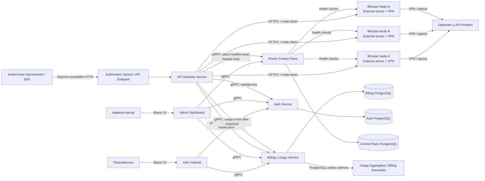

# PRD: OpenRussiaRouter

## Краткое описание

- Создаем B2B-платформу для доступа к LLM через OpenAI-compatible API: баланс в рублях, API-ключи, учет токенов, тарификация и админское управление пользователями.
- Цель MVP: готовность к платным пилотам. Можно выдать API-ключ, виртуально пополнить баланс, отправлять запросы в LLM, считать usage, списывать рубли и видеть ошибки/статус в админке.
- Архитектура: микросервисы на .NET/C#, Kubernetes, PostgreSQL per service, gRPC для внутренней связи сервисов, внешние 9Router proxy-ноды и единая .NET-точка входа.
- 9Router используем как routing engine в отдельном branch/fork. Доработки MVP минимальные: внутренний контракт health, auth, usage, errors и model mapping.

## System Design: схема взаимодействия

## Ключевые продуктовые решения

- Аудитория: B2B-разработчики и компании, но в MVP модель аккаунта простая: один пользователь владеет балансом и API-ключами.
- Доступ: регистрация только по invite от администратора, вход по email/password.
- Интерфейсы: пользовательский кабинет и админка на ASP.NET/Blazor.
- Публичный API: `/v1/chat/completions` со streaming/SSE и `/v1/models`.
- API-ключи: базовые операции create/delete/rename. Ограничение только по балансу аккаунта.
- Биллинг: prepaid-баланс в рублях, без интеграции платежного провайдера в MVP. Пополнение только виртуально через админку.
- Тарифы: таблица цен в рублях по модели и типу токенов: input/output/cache.
- Данные: prompt/response bodies по умолчанию не храним. Храним metadata, usage, стоимость, latency, статус и ошибки.
- IP-ограничения, rate limits, abuse/content policy и публичная регистрация не входят в MVP.

## Техническая архитектура

- Сервисы:
  - API Gateway: OpenAI-compatible API, проверка API-ключа, проверка баланса, выбор 9Router-ноды, proxying, streaming.
  - Auth: invite, login, пользовательские сессии/JWT, проверка пользователей и API-ключей.
  - Billing/Usage: баланс, ledger, виртуальные пополнения, usage events, цены моделей, расчет стоимости, anomalies.
  - Router Control Plane: registry 9Router-нodi, health checks, load/capacity status, enable/disable.
- Внутренняя связь:
  - Все синхронные service-to-service вызовы между .NET-сервисами идут через gRPC.
  - Gateway вызывает Auth, Billing/Usage и Router Control Plane по gRPC.
  - Контракты gRPC версионируются через `.proto` и считаются публичными внутренними интерфейсами.
  - Для фоновых событий используем PostgreSQL transactional outbox + workers, без RabbitMQ/Kafka в MVP.
- Данные:
  - У каждого сервиса своя PostgreSQL-база или отдельный database/schema ownership в одном PostgreSQL-кластере.
  - Прямые cross-service JOIN запрещены.
- 9Router:
  - Ноды живут на внешних серверах, не внутри Kubernetes.
  - Каждая нода сама отвечает за VPN/egress к upstream LLM-провайдерам.
  - Админ вручную добавляет endpoint, token, capacity и metadata.
  - Gateway выбирает только healthy-ноды по стратегии health + least load.
  - Связь с 9Router: HTTPS + static node token.
- Kubernetes:
  - .NET-сервисы деплоятся в Kubernetes.
  - Обязательны readiness/liveness probes, resource requests/limits, Secrets, RBAC, namespaces и NetworkPolicies.

## PRD-файл

- Подготовить подробный PRD на русском языке: `docs/prd/open-russia-router-prd.md`.
- Включить разделы: бизнес-цель, целевая аудитория, MVP scope, non-goals, пользовательские сценарии, System Design, API, биллинг, gRPC-контракты, интеграция с 9Router, микросервисы, политика данных, UI, инфраструктура, риски, acceptance criteria и roadmap.
- Явно вынести за пределы MVP: реальные платежи, organization/team accounts, embeddings, Responses API, public signup, IP-фильтры, moderation/abuse detection, rate limits, автоматическую self-registration 9Router-нodi.

## Acceptance Criteria

- Запрос с валидным API-ключом к `/v1/chat/completions` проходит через healthy 9Router-ноду и возвращает OpenAI-compatible ответ.
- `stream=true` возвращает корректный SSE stream, а после завершения сохраняет usage и списывает стоимость.
- `/v1/models` показывает только whitelist моделей, разрешенных в .NET-слое.
- Gateway проверяет API-ключ, баланс и доступные router-ноды через gRPC-вызовы внутренних сервисов.
- Невалидный API-ключ отклоняется.
- Нулевой или отрицательный баланс блокирует новые запросы.
- При положительном балансе запрос разрешается, usage сохраняется, стоимость в рублях рассчитывается, ledger обновляется.
- Если выбранная 9Router-нода падает до начала streaming, gateway один раз пробует другую healthy-ноду.
- Админ может добавлять, отключать и мониторить 9Router-ноды.
- Админ может виртуально пополнять баланс пользователя и менять цены моделей.
- Prompt/response bodies не сохраняются в обычных логах и persistent storage.
- Kubernetes-конфигурация содержит probes, limits, Secrets, RBAC и NetworkPolicies.

## Допущения

- PostgreSQL достаточно как единственная база данных для MVP.
- gRPC используется только для внутренних .NET service-to-service вызовов; публичный клиентский API остается HTTP/OpenAI-compatible.
- 9Router можно доработать в fork/branch под нужный внутренний контракт.
- Upstream provider credentials и VPN настраиваются вне .NET-платформы в MVP.
- Платежная и бухгалтерская автоматизация не входит в MVP, потому что пополнение виртуальное.
- "Готовность к платным пилотам" означает контролируемый запуск для первых клиентов, а не публичный production launch.
